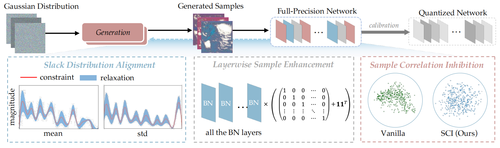

# DSG: Diverse Sample Generation — Pushing the Limit of Generative Data-Free Quantization

**IEEE TPAMI 45(10):11689–11706 · 2023**

Haotong Qin, Yifu Ding, Xiangguo Zhang, Jiakai Wang, Xianglong Liu, Jiwen Lu

[Published paper](https://doi.org/10.1109/TPAMI.2023.3272925) | [arXiv](https://arxiv.org/abs/2109.00212) | [Citation](#citation)

**Diverse Sample Generation (DSG) improves data-free quantization by diversifying synthetic calibration/training samples derived from a pretrained model.** It uses Slack Distribution Alignment (SDA), Layerwise Sample Enhancement (LSE), and Sample Correlation Inhibition (SCI) to reduce distribution- and sample-level homogenization.

## Published results and evidence

ImageNet top-1 accuracy (%) from Table 3 of the journal manuscript. W/A denotes weight/activation precision. DSG¹ and DSG² use the paper's different PTQ calibration settings; the original repository results below correspond to DSG¹.

| Model | FP32 | W/A | ZeroQ | DSG¹ | DSG² |
| --- | --- | --- | --- | --- | --- |
| ResNet-18 | 71.47 | 4/4 | 26.04 | 39.90 | 66.67 |
| ResNet-18 | 71.47 | 6/6 | 69.74 | 70.46 | 71.18 |
| ResNet-50 | 77.72 | 4/4 | 8.20 | 56.12 | 68.30 |
| InceptionV3 | 78.80 | 4/4 | 12.00 | 57.17 | 74.02 |

These are data-free **PTQ accuracy** results. They do not measure training cost, inference speed, or runtime memory. The QAT results require optimization of the quantized model and are separate from PTQ.

### What this paper supports

- Synthetic-data diversity is important for quantization, and exact BN-statistics matching can cause homogenization (Sections 3.2–3.3).
- SDA relaxes the distribution constraint; LSE diversifies the influence of BN layers; SCI discourages correlated samples (Section 3.4; Table 1).
- DSG improves the evaluated data-free PTQ settings across several ImageNet architectures, particularly at W4A4 (Table 3).
- The scheme also benefits the evaluated data-free QAT pipelines (Table 4), which should be compared separately from PTQ.
- Results depend on calibration and quantization choices; the paper studies additional calibration, DFQ, and AdaRound settings (Tables 5–7).

**Scope:** “data-free” means real training data are not accessed for quantization. The method still needs a pretrained full-precision network and its BN statistics, synthetic-data generation, and real labeled validation data to measure accuracy. This repository accompanies the TPAMI journal extension; the [CVPR 2021 precursor](https://openaccess.thecvf.com/content/CVPR2021/html/Zhang_Diversifying_Sample_Generation_for_Accurate_Data-Free_Quantization_CVPR_2021_paper.html) is a distinct publication with a different title/author order.



### 2 Dependencies

```shell
python==3.7
pytorch==1.2.0
torchvision==0.4.0
# other dependencies in requirements.txt
```

### 3 Getting Started

#### 3.1 Installation

(1) Clone this repo:

````shell
git clone https://github.com/htqin/DSG.git
````

(2) Choose one quantization scheme:

````shell
cd DSG/quantization_aware_training  # if choosing QAT
cd DSG/post_training_quantization  # if choosing PTQ
````

(3) Install pytorch and other dependencies:

````shell
pip install -r requirements.txt
````

#### 3.2 Set the paths of datasets for testing

For Post-Training Quantization (PTQ):

Set the `data_path` in run script. For example:

```shell
data_path = "/path/to/imagenet/val"
```

For Quantization-Aware Training (QAT):

Set the `dataPath` in "imagenet_resnet.hocon" if using ImageNet dataset. For example:

```shell
dataPath = "/path/to/imagenet"
```

#### 3.3 Training

For PTQ:

````shell
python3 uniform_test.py [--dataset] [--data_path] [--model] [--batch_size] [--test_batch_size] [--w_bit] [--a_bit]

optional arguments:
--dataset                   name of dataset (default: imagenet)
--data_path									path of dataset (default: /path/to/imagenet/val)
--model                     model to be quantized (default: resnet18)
--batch_size                batch size of distilled data (default: 64)
--test_batch_size           batch size of test data (default: 512)
--w_bit											bit-width of weight (default: 4)
--a_bit											bit-width of activation (default: 4)
````

For QAT:

````shell
python3 main.py [--conf_path] [--model] [--id]

optional arguments:
--conf_path 					 			configure file path (default: imagenet_resnet.hocon)
--model				  						model to be quantized (default :resnet18)
--id 												experiment id (default: 0)
````

### 4 Original repository result records

The following are the results of our DSG. We also provide models quantized by DSG-PTQ for the lowest bit-width for all network architectures and their results for easy evaluation, where parenthesized values are subsequent repository-reported results, separate from the manuscript results. These records have not been rerun in this documentation update.

| Scheme      | Model       | Dataset  | FP32  | W4A4               | W6A6               | W8A8  |
| ----------- | ----------- | -------- | ----- | ------------------------------------ | ------------------------------------ | ----- |
| DSG-PTQ* | ResNet18    | ImageNet | 71.47 | 39.90 (40.41) | 70.46                                | 71.49 |
|             | ResNet50    | ImageNet | 77.72 | 56.12 (56.36) | 76.90                                | 77.72 |
|             | InceptionV3 | ImageNet | 78.80 | 57.17 (59.58) | 78.12                                | 78.81 |
|             | SqueezeNext | ImageNet | 69.38 | -                                    | 66.23 (66.23)                  | 69.27 |
|             | ShuffleNet  | ImageNet | 65.07 | -                                    | 60.71 (60.85) | 64.87 |
| DSG-QAT     | ResNet18    | ImageNet | 71.47 | 62.18                                | 71.12                                | 71.54 |
|             | ResNet50    | ImageNet | 77.72 | 71.96                                | 77.25                                | 77.64 |
|             | ShuffleNet  | ImageNet | 65.07 | 29.71                                | 61.37                                | 64.76 |
|             | MobileNetV2 | ImageNet | 71.88 | 60.46                                | 71.48                                | 72.90 |
|             | InceptionV3 | ImageNet | 78.80 | 72.01                                | 78.60                                | 78.94 |

\* DSG-PTQ denotes DSG-PTQ^1 in manuscript

### 5 Acknowledgement

The original code is borrowed from [ZeroQ](https://github.com/amirgholami/ZeroQ) and [GDFQ](https://github.com/xushoukai/GDFQ).

## Citation

Please cite the published paper below. Open paper versions are linked at the top of this README.

```bibtex
@article{qin2023diverse,
  title = {Diverse Sample Generation: Pushing the Limit of Generative Data-Free Quantization},
  author = {Haotong Qin and Yifu Ding and Xiangguo Zhang and Jiakai Wang and Xianglong Liu and Jiwen Lu},
  journal = {IEEE Transactions on Pattern Analysis and Machine Intelligence},
  year = {2023},
  volume = {45},
  number = {10},
  pages = {11689--11706},
  doi = {10.1109/TPAMI.2023.3272925},
  url = {https://doi.org/10.1109/TPAMI.2023.3272925}
}
```
